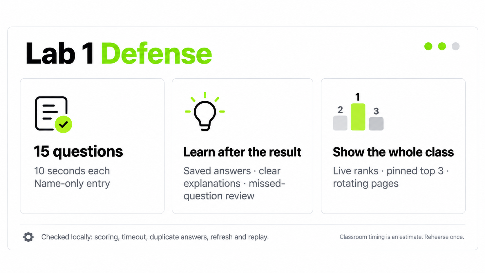

# Lab 1 Defense

A name-only live quiz for the Network Programming Lab 1 class. Students answer 15 short multiple-choice questions, with a server-enforced 10-second limit per question. The shared projector board ranks correct answers first and total answer time second.

Students: [join the quiz](https://lab1-defense-quiz.egoelevate.chatgpt.site). Projector: [live leaderboard](https://lab1-defense-quiz.egoelevate.chatgpt.site/leaderboard).

Source: [Lucian-Adrian/lab1-defense-quiz](https://github.com/Lucian-Adrian/lab1-defense-quiz). The frontend is backed by a Cloudflare Worker and shared D1 database through Sites hosting. GitHub stores the public source; this server-backed quiz runs on the linked site.

## Run locally

Requirements: Node.js 22.13 or newer, npm, and a local D1 binding named `DB`.

```sh
npm ci
npm run build
node --import ./scripts/sites-env.mjs ./node_modules/wrangler/bin/wrangler.js d1 execute DB --local --config dist/server/wrangler.json --persist-to .wrangler/state --file drizzle/0000_outstanding_lightspeed.sql
node --import ./scripts/sites-env.mjs ./node_modules/wrangler/bin/wrangler.js d1 execute DB --local --config dist/server/wrangler.json --persist-to .wrangler/state --file drizzle/0001_dashing_black_tom.sql
node --import ./scripts/sites-env.mjs ./node_modules/wrangler/bin/wrangler.js d1 execute DB --local --config dist/server/wrangler.json --persist-to .wrangler/state --file drizzle/0002_remove_verification_attempts.sql
npm run dev
```

Apply the included migrations in order, once to a new local D1 database before opening the quiz. Local preview state lives under `.wrangler/state`. Generate a new migration with `npm run db:generate` only when the schema changes. Production hosting applies the committed migrations to its shared D1 database.

For a built local Worker preview, run `npm run build` followed by `npm start`.

## Routes

- `/` starts or resumes the quiz in the browser. Enter a name from 2 to 32 characters; no account is required.
- `/leaderboard` shows the shared D1 results, progress, QR join panel, and fullscreen projector view.
- `POST /api/start` creates a new attempt and sets a random `HttpOnly; SameSite=Lax` cookie. D1 stores only a SHA-256 digest of the cookie token.
- `GET /api/state` resumes the cookie's attempt and advances any expired question.
- `POST /api/answer` accepts a choice and question index. A conditional D1 update ensures one score per question; the server checks the deadline and the correct answer.
- `GET /api/leaderboard` returns the shared standings and advances expired questions in one guarded SQL update.

The answer key and rationales live in `app/quiz-bank.ts`, which is imported only by server API code. Responses include the current prompt and choices; answer feedback is returned only after that question advances. The browser does not store scores or attempt progress in local storage.

The result is labeled **Practice grade**. It is clamped to 1.0–10.0 from the number correct out of 15 and is not an academic course grade.

The board refreshes every four seconds and lists up to 2,000 attempts. A replay creates another attempt. The database is shared across visitors; the design target's sample players are not included. The two public verification attempts were removed after the end-to-end check.

Temporary service errors preserve the displayed round and trigger automatic recovery. Delayed responses cannot replace a newer question or a fresh replay. The server continues enforcing deadlines while a phone reconnects.

## Focused local API test

Start a local preview with D1 migrated, then run the API test against loopback. It creates test players in that local database, probes the first answer by normal quiz feedback, races duplicate submissions, waits through one timer, and checks that separate attempts appear on the same board.

PowerShell:

```powershell
$env:QUIZ_TEST_ORIGIN = 'http://127.0.0.1:8787'
node --test tests/quiz-api.test.mjs
node --test tests/quiz-lifecycle.test.mjs
```

The test refuses any non-loopback URL. It is skipped when `QUIZ_TEST_ORIGIN` is unset.

After the result, students can review their missed questions and the reason behind each answer. Saved answer history survives refresh. Older attempts created before answer history was added keep their grade without an invented review.

For a larger class, Auto view keeps the top three visible and rotates seven more rows every eight seconds. Pause or use the arrows to control it. All players restores the complete list. During a round, a 1.5-second answer note separates questions; the 10-second answer timer starts after that note.


